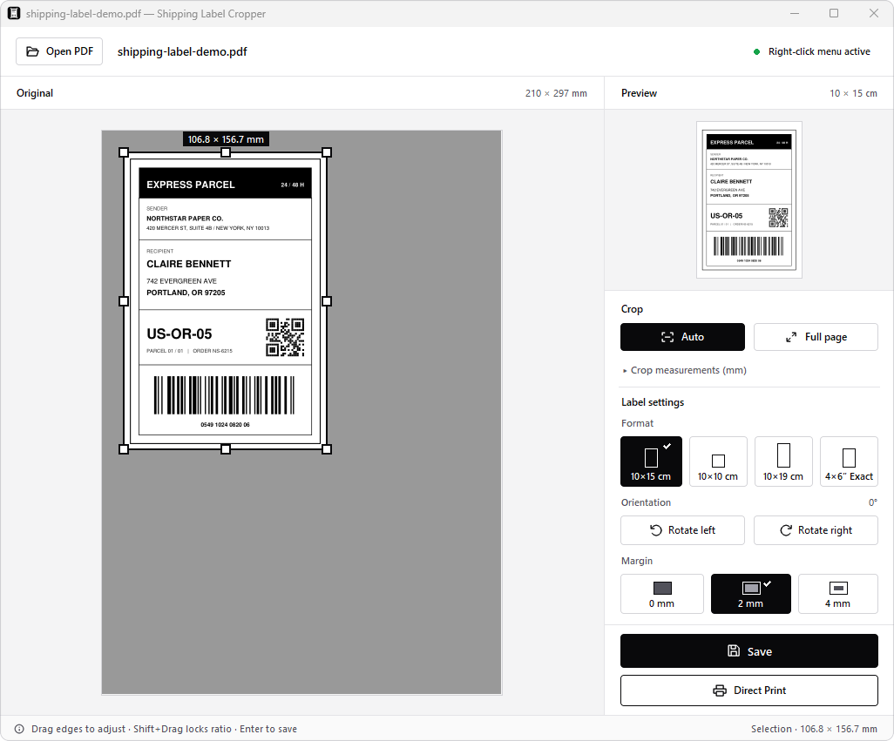

# Shipping Label Cropper

[](https://github.com/cristianmontanari/shipping-label-cropper/actions/workflows/ci.yml)
[](LICENSE)
[](https://www.python.org/downloads/)
[](#installation)

Minimal desktop app for **Windows, macOS, and Linux** to crop **A4 PDF shipping labels** to crisp, 100% vector **4×6" (10×15 cm)** format for thermal label printers — with right-click file manager integration and direct thermal printing.



## Why use it
Most marketplaces and couriers export shipping labels inside an **A4 PDF** surrounded by white margins or folding instructions. Printing that directly on a **4×6" / 10×15 cm thermal printer** shrinks the barcode or clips the label. **Shipping Label Cropper** auto-detects the label bounds, lets you rotate the label manually, exports a pure vector `100 × 150 mm` PDF (no blurry rasterization), and prints straight to your thermal printer.

> **Privacy-first & 100% offline:** Shipping labels contain customer names, addresses, and tracking numbers. Everything in **Shipping Label Cropper** runs locally on your computer — your PDFs are never uploaded to any server, with zero telemetry, tracking, or network requests.

## Works great with
- **Marketplaces & e-commerce:** eBay, Vinted, Amazon, Etsy, Shopify, Subito, Wallapop, Depop, WooCommerce
- **Couriers:** DHL, UPS, FedEx, USPS, GLS, BRT, DPD, Poste Italiane, InPost, Royal Mail, Mondial Relay
- **4×6" / 10×15 cm thermal printers:** Zebra, Rollo, Munbyn, Phomemo, iDPRT, Nelko, Jadens, Brother, Dymo, Polono, and any Windows or CUPS thermal label printer

## Features
- **100% local & offline**: no accounts, no cloud uploads, no internet connection required after installation.
- **Right-click / file manager integration**:
  - **Windows**: `Shift + Right-click` on Windows 11 (or `Show more options` → **Crop Shipping Label**), plus **Send to**.
  - **macOS**: Finder **Quick Actions** (`Right-click PDF → Quick Actions → Crop Shipping Label`).
  - **Linux**: XDG `.desktop` entry (`Right-click PDF → Open With → Crop Shipping Label`), plus Nautilus Scripts / KDE Dolphin Actions when installed.
- **100% vector output** on exact thermal page sizes (`10 × 15 cm`, `10.2 × 15.2 cm` / exact 4×6", `10 × 10 cm`, `10 × 19 cm`) — razor-sharp barcodes, QR codes, and text.
- **Auto-detection** of label bounds on open + quick presets (`Auto`, `Full page`).
- **Manual rotation** with **Rotate left** and **Rotate right** controls.
- **Live preview** in real time (click to enlarge with scroll-wheel zoom), multi-page support, quick save (`_10x15.pdf`), and **direct thermal printing** (Windows print subsystem or CUPS on Linux/macOS, with print darkness and speed controls when supported by the printer driver).

## Keyboard Shortcuts
- `Enter` / `Ctrl+S` (`Cmd+S` on macOS): Save cropped PDF
- `Ctrl+Shift+S` (`Cmd+Shift+S` on macOS): Save As…
- `Ctrl+O` (`Cmd+O` on macOS): Open PDF
- `Ctrl+P` (`Cmd+P` on macOS): Direct Print
- `Ctrl+Z` / `Ctrl+Y` (`Cmd+Z` / `Cmd+Shift+Z` on macOS): Undo / Redo crop & rotation
- `A` or double-click: Auto-detect label
- `R` / `Shift+R`: Rotate +90° / −90°
- `Arrow keys`: Nudge crop by 1 mm (`Shift + Arrows`: 5 mm)
- `Shift + Drag`: Lock selection to output label aspect ratio
- `Esc`: Cancel active drag or close expanded preview / dialog

## Installation

### Option 1: Prebuilt Downloads (no Python or Git required)

Download the build for your OS from the latest [GitHub Release](https://github.com/cristianmontanari/shipping-label-cropper/releases/latest) (each build includes a `.sha256` checksum):

#### Windows (x64)
1. Download **`ShippingLabelCropper-windows-x64.exe`**.
2. Move it to a permanent folder (e.g. `C:\Tools\ShippingLabelCropper\`) and double-click to launch.
3. Click **"Enable right-click menu"** in the top-right corner of the app to register the Windows Explorer context menu (no administrator privileges required).

> **Windows SmartScreen note:** Because the executable is not code-signed, Windows may show *"Windows protected your PC"* on first run. Click **More info → Run anyway** (or run from source below).

#### macOS (Apple Silicon & Intel)
1. Download **`ShippingLabelCropper-macos-arm64.dmg`** (Apple Silicon M1/M2/M3/M4) or **`ShippingLabelCropper-macos-x64.dmg`** (Intel Mac).
2. Open the `.dmg` and drag **`Shipping Label Cropper.app`** into **Applications**.
3. Open the app and click **"Enable Quick Action"** in the top-right corner to add **Crop Shipping Label** to Finder's right-click **Quick Actions** menu.

> **macOS Gatekeeper note:** Because the app is not notarized with a paid Apple Developer certificate, macOS may block it on first open. Go to **System Settings → Privacy & Security → Open Anyway**, or run:
> ```bash
> xattr -cr "/Applications/Shipping Label Cropper.app"
> ```

#### Linux (x64)
1. Download **`ShippingLabelCropper-linux-x64.tar.gz`** (built on Ubuntu 24.04).
2. Extract it to a permanent folder (e.g. `~/Applications/ShippingLabelCropper/`) and run **`./ShippingLabelCropper`**.
3. Click **"Enable file menu"** in the top-right corner to register the `.desktop` entry (and Nautilus/Dolphin actions if installed).

---

### Option 2: From Source (Windows, macOS, Linux)

Clone the repository (or click **Code → Download ZIP** and extract it):

```bash
git clone https://github.com/cristianmontanari/shipping-label-cropper.git
cd shipping-label-cropper
```

#### Windows (10 / 11)
Requirements: **Python 3.10+** (if not installed, the setup script tries to install it automatically via `winget`).

1. Run **`install_menu.bat`** to find/install Python, create `.venv`, install dependencies, and enable the right-click context menu (no administrator privileges required).
2. Use **`launch_app.bat`** to launch the app manually or **`uninstall_menu.bat`** to remove the context menu.

#### macOS & Linux
Requirements: **Python 3.10+** with `tkinter` and `venv`, plus **CUPS** (`lp`/`lpstat`, preinstalled on macOS and standard on Linux) for direct printing.
- On Debian/Ubuntu: `sudo apt install python3-tk python3-venv`
- On Fedora: `sudo dnf install python3-tkinter`
- On Arch: `sudo pacman -S tk`
- On macOS (Homebrew): `brew install python-tk@3.12` (or use the official Python.org installer, which includes Tk)

1. Run **`./install_menu.sh`** (or `bash install_menu.sh`) to create `.venv`, install dependencies, and register the Finder Quick Action / Linux file manager menu.
2. Use **`./launch_app.sh [file.pdf]`** to launch the app manually or **`./uninstall_menu.sh`** to remove the integration.

## Troubleshooting
- **Right-click menu not visible on Windows 11:** Windows 11 hides classic shell entries under **Show more options** — hold `Shift + Right-click` on a PDF to open the full menu directly.
- **Label prints small or misaligned on thermal printer:** Make sure your thermal printer driver's default paper size is set to `100 × 150 mm` (or `4 × 6 in`) in Windows *Printers & scanners → Printing preferences* (or CUPS settings on macOS/Linux).
- **Moved the standalone app to another folder:** Open the app and toggle the top-right file-menu badge off and back on so the OS updates the stored executable path.
- **Linux standalone binary reports a `GLIBC` version error on older distros:** Run from source using Option 2 above.

## Contributing & Security
- Contributions are welcome! See [CONTRIBUTING.md](CONTRIBUTING.md) for local setup and testing instructions.
- See [CHANGELOG.md](CHANGELOG.md) for release history and [SECURITY.md](SECURITY.md) for reporting vulnerabilities.

## License
Released under the [GNU Affero General Public License v3.0 (AGPL-3.0)](LICENSE).
